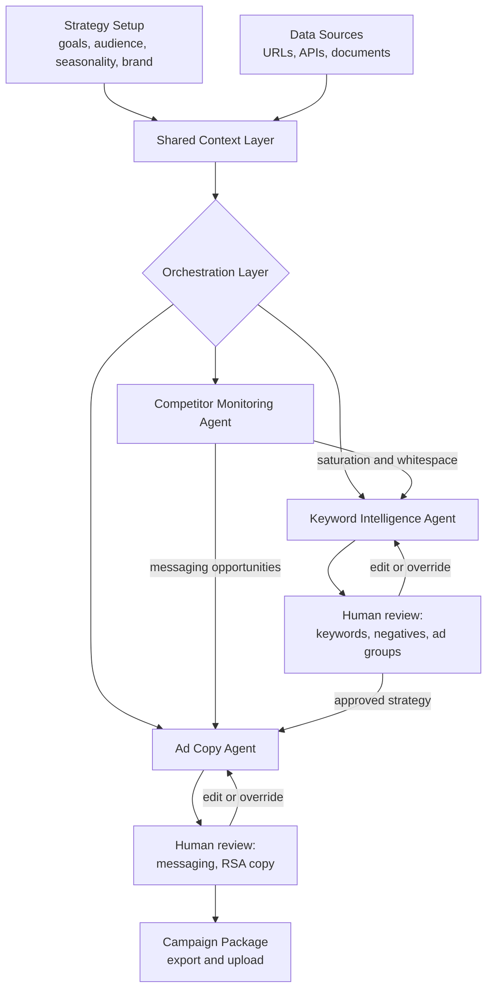

# CampaignAI: Multi-Agent Google Ads Pre-Launch System Design & Prototype Video

A multi-agent system design for turning campaign inputs into a structured, launch-ready Google Search campaign package, with a human review checkpoint at each key decision.

> [Disclaimer]
> **Prototype only. Not production ready.**
> This repository contains a system design and a clickable front-end prototype. The agents are simulated in the browser and all data is illustrative. Nothing connects to Google Ads, an LLM, or any live data source.

## Problem

In the Google Ads pre-launch phase, most search campaigns are built in silos, without fully integrating audience, competitor, and performance data before launch.

## Solution

An agentic system that produces a complete campaign package, ready for export and upload:

- Prioritized keywords
- Ad groups
- Negative keywords
- Responsive Search Ad (RSA) copy
- Competitor insights
- Quality scorecards and rationale

## Demo

| Part | Covers | Length |
| --- | --- | --- |
| [Part 1](docs/demo/part-1-overview-and-setup.mp4) | Overview, Strategy Setup, Data Sources, Competitor Monitoring | 1:26 |
| [Part 2](docs/demo/part-2-keywords-and-competitors.mp4) | Keyword scoring and shortlist, Competitor Monitoring, Ad Copy Studio | 2:00 |
| [Part 3](docs/demo/part-3-ad-copy-and-approvals.mp4) | Ad Copy Studio, approval gates, audit trail, reviewer controls | 1:36 |

To try the prototype, download [`prototype/index.html`](prototype/index.html) and open it in a browser. It has no dependencies or build step.

## Architecture

An orchestration layer coordinates three agents through shared context. Each agent has a scoring layer, and its output passes through human review before final export.



### Agents

| Agent | Responsibility | Output |
| --- | --- | --- |
| **Keyword Intelligence** | Expands seed keywords, classifies search intent, and organizes keywords by intent and audience segment | Scored keywords, ad groups, negatives |
| **Competitor Monitoring** | Tracks competitor messaging, promotions, and trends to find what is saturated and where there is opportunity | Whitespace analysis, urgency alerts, recommended angles |
| **Ad Copy** | Turns the approved keyword strategy and competitor insights into RSAs aligned with audience, seasonality, landing pages, and brand guidelines | RSA assets with scorecards |

### Shared context

All three agents draw on the same inputs from **Strategy Setup** and **Data Sources**, where users enter campaign goals, audience, and seasonality, and connect data sources, URLs, and APIs. This keeps keyword strategy and ad copy aligned with campaign objectives.

### Scoring

Keyword priority in the prototype uses a weighted formula, with weights adjustable by reviewers:

```text
score = 0.25 × Search Intent Fit
      + 0.20 × Audience Relevance
      + 0.15 × Seasonality
      + 0.15 × Search Volume
      + 0.10 × CPC Efficiency
      + 0.10 × Historical Performance
      + 0.05 × Competitor Whitespace
```

Ad copy is scored on brand voice fit, landing page relevance, audience match, policy safety, keyword coverage, and seasonal fit.

### Human in the loop

Reviewers can approve, edit, or override decisions before deployment. The prototype models five approval gates, each recorded in an audit trail:

1. Keyword shortlist
2. Negative keywords
3. Ad group structure
4. Competitor messaging
5. Final RSA copy

## What the prototype does and does not do

| Implemented in the prototype | Not implemented |
| --- | --- |
| Dashboard and navigation for each stage | Real agents or LLM calls |
| Keyword filtering, approve and reject actions | Orchestration runtime and shared context store |
| Ad copy review and headline pinning | Google Ads, GA4, CRM, or other API integrations |
| Approval gates and an in-session audit trail | Competitor scraping or monitoring |
| Scoring weight controls | Live scoring against real data |
| Export dialog | Authentication, persistence, and access control |
| | Google Ads policy validation, testing, and monitoring |

## Path to production

1. Implement the orchestrator and a versioned shared context store.
2. Build each agent with structured outputs and evaluation sets.
3. Connect the Google Ads API, keyword data, analytics, and compliant competitor data sources.
4. Persist approvals and audit events, with role-based access.
5. Validate exports against Google Ads Editor formats and ad policies.
6. Close the feedback loop by feeding post-launch performance into scoring.

## Disclaimer

The demo uses Uniqlo and its competitors as an illustrative scenario only. This project is not affiliated with or endorsed by any brand mentioned. All keywords, metrics, promotions, reviewer names, and scores are sample data and should not be read as real market or company information.
